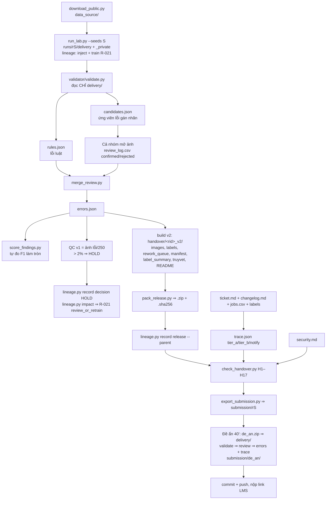

# Personal Guide — Day 10 Lab: Bàn giao dataset & Truy vết

> Ghi chú cá nhân tổng hợp từ toàn bộ repo (README, GUIDE, RULES, RUBRIC, SUBMISSION, CHECKPOINTS, docs/DELIVERY, mọi script trong `scripts/`, `tests/`, `templates/`).
> Trạng thái repo lúc viết: **chưa có code nhóm** — `validator/` chỉ có README, `submission/*.md` vẫn là mẫu `<<...>>`, chưa có `runs/` và `data_source/`.

---

## 1. Context — bài lab nói về chuyện gì

Bạn đóng vai **team dữ liệu** vừa nhận một lô (batch/release) gồm **250 ảnh COCO val2017**. Mỗi ảnh có **hai nguồn nhãn**:

- **Detection** (YOLO, 80 lớp): `labels/<ảnh>.txt`, mỗi dòng `class_id x_center y_center w h` (chuẩn hoá 0–1).
- **Panoptic**: `masks/<ảnh>.png` (mỗi pixel mã hoá id segment = `R + G·256 + B·256²`) + `panoptic.json` (`segments_info`: id, category_id, area, bbox, iscrowd).

Kèm theo là "giấy tờ" giả lập của một quy trình gán nhãn thật: cảnh (5 ảnh/cảnh), job (25 ảnh/job → 10 job) với người gán `A0x`, người kiểm `Q0x`, phiên bản guideline (job đầu v1.2, job sau v1.3), changelog guideline và **ticket của team AI** báo model hay bỏ sót một lớp.

Trong lô **có lỗi được gài theo seed** (số lỗi mỗi loại 0–3, mỗi ảnh tối đa 1 lỗi) và **không có nhãn gốc** để so. Nhóm phải:

1. Tự viết **validator** bắt lỗi.
2. **Đối chiếu detection ↔ panoptic** để tìm ứng viên lỗi gán nhãn, rồi **mở ảnh ra xem** để xác nhận.
3. **Quyết định** Release/Hold theo ngưỡng 2% và ghi **lineage**.
4. **Bàn giao lô v2** (không ghi đè v1) có manifest sha256, thống kê nhãn, truy vết, hàng đợi gán lại.
5. **Truy vết ticket**: ảnh nào bị ảnh hưởng (tầng a/b), phải báo ai.
6. Viết phần **bảo mật**, rồi làm **đề ẩn 40 phút** trên 250 ảnh khác (tên ảnh mã hoá `img_0001`, ảnh đã lật/nén lại, mức lỗi có thể khác).

Bài nhóm 5–6 người, ~4 giờ, Python 3.10+ **chỉ thư viện chuẩn**, không cần GPU.

---

## 2. Ý nghĩa — học được gì

| Bài học | Diễn giải |
|---|---|
| **Hai loại lỗi** | *Lỗi luật* (hash, class id, box tràn, split…) máy bắt được 100%. *Lỗi gán nhãn* (gán nhầm lớp, box lệch, thiếu box, gộp instance) chỉ thấy khi **đối chiếu hai nguồn** + **mắt người**. Một F1 tổng cao có thể che việc bỏ sót loại thứ hai → điểm chấm tách hai nhóm. |
| **Precision vs recall khi không có đáp án** | Điểm là F1 trên cặp `(type, target)`; báo thừa bị trừ như bỏ sót. COCO vốn lệch tự nhiên giữa hai nguồn (vật bị che, crowd) → báo hết ứng viên làm precision sụt, F1 giảm (~0,6 so với ~0,7 chỉ kiểm luật và >0,9 khi xem ảnh cẩn thận). |
| **Quyết định theo ngưỡng** | Tỉ lệ ảnh lỗi > 2% ⇒ không Release (quy tắc Day 7). Tính theo **tỉ lệ ảnh**, không theo số lỗi. |
| **Lineage** | Ghi lại quyết định HOLD → truy ra training run `R-021` đã train trên lô lỗi → phải *review_or_retrain*. Sửa dataset **không** tự sửa model đã học. |
| **Bàn giao không ghi đè** | v1 bất biến (release_id = hash của manifest+metadata). v2 là lô mới có `parent`, có manifest sha256, zip tái lập được. Hash chứng minh *tính toàn vẹn/không bị đổi*, **không** chứng minh *nhãn đúng*. |
| **Truy vết** | Từ một ticket → khoanh vùng ảnh cần mở lại (tầng a: đã báo, tầng b: chưa ai báo) và người phải báo, dựa vào guideline **theo job**. |
| **Bảo mật dữ liệu** | Không mang dữ liệu ra ngoài, không dán dữ liệu thật lên chatbot; thấy mặt người rõ ⇒ **Hold + báo người phụ trách**, không tự làm mờ/xoá. |

---

## 3. Bản đồ repo

```text
README.md, GUIDE.md, RULES.md, RUBRIC.md, SUBMISSION.md, CHECKPOINTS.md   # đề bài
docs/DELIVERY.md          # định dạng lô, 14 loại lỗi, format errors.json
docs/assets/              # hình minh hoạ (make_figures.py của giảng viên)
examples/errors.sample.json
templates/                # mẫu README.txt (v2), review_log.csv, trace.json, security.md
validator/                # NHÓM TỰ VIẾT validate.py ở đây (hiện chỉ có README)
submission/               # TEAM.md, REPORT.md, prompts.md (mẫu, cần điền) + r<seed>/, de_an/
scripts/                  # script giảng viên — KHÔNG ĐƯỢC SỬA
tests/test_pipeline.py    # unittest kiểm pipeline của giảng viên
```

### Các script có sẵn (đọc code thật)

| Script | Làm gì bên trong |
|---|---|
| `download_public.py` | Tải annotation COCO 2017 (instances + panoptic) và ảnh val2017 (16 luồng, retry). Chọn ảnh có box non-crowd + có panoptic, sort theo id: vị trí 1–250 = pool **practice**, 251–500 = **test** (đề ẩn), 501–550 = **calib** (lô sạch). Ghi vào `data_source/coco250*/` và `data_source/coco_panoptic250*/`. Mặc định tải practice + calib (~1 GB). |
| `inject_release.py` | Tạo **một** lô: nạp nguồn → bỏ box trùng tự nhiên (cùng lớp, IoU>0,7) → `organize()` (cảnh 5 ảnh liền nhau, 30% cảnh vào val, job 25 ảnh, 3–4 job đầu v1.2) → `inject()` gài lỗi → `story()` chọn lớp bị đổi quy tắc + 2 cảnh bị báo → `write()` ra `delivery/` và `_private/` (truth.json, trace_truth.json). `--no-faults` = lô sạch trên pool calib; `--opaque` = đề ẩn (đổi tên `img_xxxx`, xáo thứ tự, chèn COM segment vào JPEG, đánh số lại segment id). |
| `run_lab.py` | Gọi `inject_release.py` cho các seed, ghi event `inject` vào lineage, và **lần chạy đầu** ghi event `train` `R-021` gắn với release của seed đầu. |
| `pngutil.py` | Đọc/ghi PNG RGB 8-bit thuần Python; `segment_id(pixels, i)`, `segment_rgb(id)`. **Validator được import file này.** |
| `metrics.py` | `RULE_TYPES` (9 loại), `SEMANTIC_TYPES` (5 loại), hàm `score()` (TP/FP/FN, P, R, F1), `group_scores()`. |
| `score_findings.py` | So `errors.json` + `trace.json` với `_private/`. Chế độ học viên chỉ in F1 **làm tròn 1 chữ số** (tổng / luật / gán nhãn / truy vết). `--truth-dir` là chế độ giảng viên — **cấm dùng**. |
| `merge_review.py` | `errors.json` cuối = lỗi luật trong `rules.json` (bỏ hết lỗi gán nhãn trong đó) ∪ các dòng `confirmed` của `review_log.csv`. |
| `lineage.py` | Append-only `runs/lineage.jsonl`. `record --event decision/release/...`; `impact --release-id X` → run train trên X bị ảnh hưởng nếu X đã HOLD. |
| `pack_release.py` | Zip **tái lập**: file sort cố định, timestamp 2026-01-01, quyền 644 → ghi `<v2>.zip` và `<v2>.sha256`. |
| `check_handover.py` | Bộ kiểm H1–H17 (chi tiết ở mục 7.4). PASS = đúng định dạng & nhất quán, **không** nghĩa là nhãn đúng. |
| `export_submission.py` | `--run runs/r<seed>` chép errors/candidates/review_log/trace/security/handover (trừ .zip) + lineage sang `submission/`. `--import` cho người chấm tạo lại lô. |

---

## 4. Định dạng lô (`runs/r<seed>/delivery/`)

```text
images/*.jpg            ảnh (có thể thiếu file)
labels/*.txt            YOLO: class_id xc yc w h (0–1)
masks/*.png             panoptic, id = R + G*256 + B*65536 (0 = nền)
panoptic.json           categories (id COCO gốc, name, isthing), images, annotations[segments_info]
classes.txt             "class_id tên" cho 80 lớp
manifest.json           items[name] = {image, label, mask, image_sha256, label_sha256, mask_sha256}
metadata.json           items = [{image, scene_id, split, job_id, guideline_version}]
jobs.csv                job_id, annotator, reviewer, guideline
guideline/changelog.md  v1.3 đổi quy tắc của 1 lớp (vật bị che >50% / cắt mép vẫn phải gán box)
incoming/ticket.md      team AI báo bỏ sót lớp đó, nêu 2 scene
release.json            release_id = "lab250_" + sha256(manifest.json + metadata.json)[:12]
../_private/            ĐÁP ÁN — validator & nhóm KHÔNG ĐỌC
```

Ghép hai nguồn qua **tên lớp**: `classes.txt` (id 0–79) ↔ `panoptic.json.categories` (id COCO gốc 1–90, có lỗ).

---

## 5. 14 loại lỗi & cách bắt

Đơn vị chấm: cặp `(type, target)`. `target` = tên ảnh không đuôi; riêng `scene_leak` target = `scene_id`.

### 5.1 Lỗi luật (máy bắt được, mục tiêu F1 ≈ 1,0)

| Loại | Định nghĩa | Cách kiểm trong validator |
|---|---|---|
| `missing_image` | manifest có ảnh nhưng file không tồn tại | `not (d / item["image"]).is_file()` |
| `wrong_hash` | sha256 trong manifest là của **ảnh khác** (vẫn đúng định dạng 64 hex) | đọc file `rb`, `hashlib.sha256(bytes)` rồi so; đừng chỉ kiểm format. Ảnh thật vẫn nguyên vẹn. |
| `invalid_class` | class_id ngoài 0–79 (thực tế gài = `80`) | parse từng dòng label |
| `bbox_out_of_bounds` | box tràn mép (gài: mép phải 1,02–1,08) | `xc ± w/2`, `yc ± h/2` ra ngoài [0,1] (bộ kiểm dùng dung sai 0,01) |
| `duplicate_box` | box lặp: **cùng lớp, cùng w/h**, tâm lệch 1–2 pixel | so cặp box cùng lớp: `w`,`h` gần như bằng nhau và \|Δx·W\|,\|Δy·H\| ≤ ~2–3 px. Đừng dùng IoU thấp (COCO có cặp tự nhiên IoU ~0,66; cặp tự nhiên IoU>0,7 đã bị dedupe khi tạo lô). |
| `scene_leak` | một ảnh của cảnh bị đổi split ⇒ cảnh có cả train và val | gom `metadata` theo `scene_id`, `len(set(split)) > 1` → target = **scene_id** |
| `guideline_mismatch` | `guideline_version` của ảnh ≠ `guideline` của job trong `jobs.csv` | so trực tiếp với job (không so với "đa số ảnh") |
| `invalid_category_id` | `category_id` không có trong `categories` (nằm trong khoảng trống id) | set id hợp lệ |
| `thing_overlap` | segment bị segment khác "ăn" pixel ⇒ `area` khai **lớn hơn** số pixel thật | đếm pixel theo id trong mask (`pngutil`), bỏ id 0, so với `area`; segment có `area` > đếm thật (vượt rõ) ⇒ lỗi |

Lưu ý: mỗi ảnh tối đa 1 lỗi — nếu một ảnh dính nhiều luật, cân nhắc ưu tiên (ví dụ `missing_image` thì không kiểm hash). Lô sạch (`runs/clean`) phải ra **0 lỗi luật**.

### 5.2 Lỗi gán nhãn (cross-check + xem ảnh)

| Loại | Gài thế nào (theo `inject_release.py`) | Dấu hiệu khi đối chiếu |
|---|---|---|
| `class_swap` | đổi lớp 1 box detection (≥0,5% diện tích ảnh), 70% sang lớp dễ nhầm (car/truck/bus, cat/dog, cup/wine glass/bowl…) | box khớp vị trí 1 segment nhưng **khác lớp**; ảnh cho thấy detection sai |
| `category_swap` | đổi lớp 1 segment panoptic (≥1024 px), cùng nhóm dễ nhầm | như trên, nhưng ảnh cho thấy **panoptic** sai |
| `bbox_drift` | dịch tâm box 12–30% kích thước box theo hướng bất kỳ, nửa số ca đổi cỡ ±20% | segment cùng lớp có **nhiều pixel rơi ra ngoài box** |
| `missing_box` | xoá 1 box > 1% diện tích ảnh | segment thing lớn (non-crowd) **không có box nào** ghép được |
| `instance_merge` | gộp segment nhỏ vào segment lớn cùng lớp (xoá khỏi `segments_info`) | **một segment phủ hai box cùng lớp** |

Đề ẩn có thể đổi mức lỗi (độ lệch, tỉ lệ lớp dễ nhầm, số lượng) → đừng cố định ngưỡng theo đúng tham số trên; dựa vào tín hiệu đối chiếu.

---

## 6. Luồng end-to-end tổng thể



---

## 7. Chi tiết từng pha (việc phải làm + lệnh)

Windows (PowerShell): dùng `py -X utf8 ...`, chạy từng lệnh riêng (không `&&`). Mọi lệnh chạy từ gốc repo.

### Pha 0 — Chuẩn bị (~15')

```powershell
py --version                                   # cần 3.10+
py -X utf8 scripts/download_public.py          # ~1 GB, một lần
py -X utf8 scripts/run_lab.py --seeds 83       # seed luyện tập của nhóm 83
```

- Kết quả: `runs/r83/delivery/`, `runs/r83/_private/` (không mở!), `runs/lineage.jsonl` có `inject` + `train R-021`.
- **Chỉ chạy `run_lab.py` một lần.** Seed thêm để thử: `py scripts/inject_release.py --seed 11 --out runs/r11`.
- Lô sạch đo nhiễu: `py scripts/inject_release.py --seed 5 --no-faults --out runs/clean` (50 ảnh **khác**).
- Chia việc, điền `submission/TEAM.md` (tên, MSHV, GitHub, phần chính, seed), commit `P0: chia viec`.

### Pha 1 — Validator luật (~40')

Giao diện **cố định**:

```
python validator/validate.py <delivery_dir> --out <errors.json> [--candidates <candidates.json>]
```

Ràng buộc: chỉ đọc thư mục delivery truyền vào; chỉ stdlib (+ `scripts/pngutil.py`); không mạng; không đọc `_private/`, `data_source/`; không hard-code tên ảnh/đáp án.

Cấu trúc code gợi ý:

```text
validate.py
├── load(delivery)          manifest, metadata, jobs, classes, panoptic, labels (parse YOLO)
├── check_files()           missing_image, wrong_hash
├── check_labels()          invalid_class, bbox_out_of_bounds, duplicate_box
├── check_metadata()        scene_leak (target scene_id), guideline_mismatch (theo job)
├── check_panoptic()        invalid_category_id, thing_overlap (đếm pixel mask so area)
├── cross_check()           sinh candidates (Pha 2)
├── resolve_one_per_image() mỗi ảnh ≤ 1 lỗi
└── main()                  ghi {"errors":[...]} ra --out; candidates ra --candidates
```

Gợi ý: ghi lỗi luật ra `rules.json` (để Pha 2 merge), hoặc `--out errors.json` khi chỉ chạy luật.

Tự kiểm:

```powershell
py -X utf8 validator/validate.py runs/r83/delivery --out runs/r83/errors.json
py -X utf8 scripts/score_findings.py --run runs/r83     # lỗi luật ≈ 1.0
py -X utf8 validator/validate.py runs/clean/delivery --out runs/clean/errors.json   # phải 0 lỗi luật
```

Đạt CP1 khi F1 luật ≈ 1,0 trên ≥ 2 seed + lô sạch. Ghi prompt AI vào `submission/prompts.md`.

### Pha 2 — Đối chiếu det ↔ panoptic + xem ảnh (~55')

**Thuật toán cross-check (trong validator, phần `--candidates`):**

1. Box YOLO → pixel: `x0=(xc-w/2)·W`, `y0=(yc-h/2)·H`, `x1`, `y1`. Tên lớp qua `classes.txt`.
2. Từ mask: mỗi segment thing non-crowd → tập pixel (hoặc đếm + bbox). Tên lớp qua `categories`.
3. **Ghép** box ↔ segment: ưu tiên tín hiệu **pixel** — tỉ lệ pixel của segment nằm trong box (`inside_frac`), kèm IoU bbox. Cặp đúng: `inside_frac` ≈ 1.
4. Sinh ứng viên:
   - Ghép tốt về vị trí nhưng **khác lớp** → `class_swap` *hoặc* `category_swap` (để mắt quyết định).
   - Cùng lớp nhưng `inside_frac` thấp / box lệch rõ → `bbox_drift`.
   - Segment lớn không box nào phủ → `missing_box`.
   - Một segment có pixel trong **hai** box cùng lớp (mỗi box chứa phần đáng kể) → `instance_merge`.
5. Ghi `candidates.json` (format tự chọn, nên có image, type gợi ý, lớp hai bên, box/segment, điểm số).

**Hiệu chỉnh ngưỡng:** chạy trên `runs/clean` → mọi ứng viên ở đó là **lệch tự nhiên**. Chỉnh ngưỡng để hàng đợi đủ nhỏ để xem hết mà không bỏ sót. Ghi số ứng viên trên lô sạch + lý do chọn ngưỡng vào `REPORT.md`. (Không dùng `_private` hay dò điểm để chọn ngưỡng.)

**Xem ảnh (mỗi người đều phải xem):**

- Nên viết một công cụ nhỏ riêng (được dùng Pillow) vẽ box detection + viền segment lên ảnh, phóng to vùng vật (ảnh có thể chỉ ~240×320).
- Ghi `runs/r<seed>/review_log.csv`:

  ```csv
  image,type,verdict,note
  000000xxxxxx,class_swap,confirmed,"mở ảnh: xe tải mui kín, detection ghi car; panoptic ghi truck đúng"
  000000yyyyyy,bbox_drift,rejected,"box lệch mask do người bị cây che một phần; nhãn hợp lý"
  ```

  - Note **≥ 20 ký tự**, nói *thấy gì*, không lặp lại (≥ 70% note khác nhau), ghi ai xem.
  - Phân biệt `class_swap` (detection sai) vs `category_swap` (panoptic sai) **bằng ảnh**.
  - Ca lệch tự nhiên (che khuất, crowd) → `rejected` kèm lý do.

**Chốt errors.json:**

```powershell
py -X utf8 scripts/merge_review.py --rules runs/r83/rules.json --review runs/r83/review_log.csv --out runs/r83/errors.json
py -X utf8 scripts/score_findings.py --run runs/r83
```

Trả lời trong REPORT: *vì sao báo hết ứng viên làm F1 giảm* (dùng số thật: số ứng viên vs số confirmed, precision tụt).

### Pha 3 — Quyết định + lineage (~15')

1. `QC v1 = số target khác nhau trong errors.json / 250` (scene_leak tính 1). Với mức lỗi mặc định (~15–30 lỗi) gần như chắc chắn > 2% ⇒ **HOLD**.
2. Lấy `release_id` v1 từ `delivery/release.json`:

   ```powershell
   py -X utf8 scripts/lineage.py record --event decision --release-id lab250_XXXXXXXXXXXX --decision HOLD
   py -X utf8 scripts/lineage.py impact --release-id lab250_XXXXXXXXXXXX
   # mong đợi: R-021: affected=True action=review_or_retrain
   ```

3. REPORT giải thích: R-021 đã học từ nhãn lỗi; sửa dataset không sửa trọng số → phải xem lại/train lại.

### Pha 4 — Bàn giao v2 (~40')

Tạo `runs/r<seed>/handover/<release_id>_v2/`. **Tuyệt đối không sửa `delivery/`** (H1 sẽ FAIL; nếu lỡ sửa thì tạo lại lô cùng seed bằng `inject_release.py`, không chạy lại `run_lab.py`).

**Phân loại ảnh theo lỗi:**

| Nhóm lỗi | Xử lý |
|---|---|
| `wrong_hash` | Mở ảnh kiểm: còn nguyên (trường hợp gài luôn là vậy) → giữ ảnh trong v2, manifest.csv ghi hash thật. Ảnh hỏng → rework. |
| `guideline_mismatch` | Giữ ảnh; `truyvet.csv` ghi guideline **theo job**. |
| `scene_leak` | Giữ ảnh; đưa cả cảnh về **một split** (split của đa số ảnh trong cảnh) trong `truyvet.csv`. |
| `missing_image`, `invalid_class`, `bbox_out_of_bounds`, `duplicate_box`, `class_swap`, `bbox_drift`, `missing_box` | **Rời v2**, vào `rework_queue.csv`. |
| `invalid_category_id`, `thing_overlap`, `category_swap`, `instance_merge` (chỉ panoptic) | **Ở lại v2** (nhãn detection vẫn đúng), ghi vào Ghi chú README để báo team panoptic. **Không** đưa vào rework (H5). |

**Các file trong v2** (nên viết một script nhóm, ví dụ `tools/build_handover.py`, để tái lập — không đặt trong `scripts/`):

| File | Cách tạo |
|---|---|
| `images/`, `labels/` | chép **byte-nguyên** từ delivery cho mọi ảnh không rework (không sửa tay nhãn — H7 so sha với `label_sha256` của v1). images/ và labels/ phải khớp tên. |
| `rework_queue.csv` | `image,type,annotator,reviewer,action` — annotator/reviewer lấy từ `jobs.csv` theo `job_id` của ảnh (H6); action ví dụ `relabel`. Mọi ảnh ở đây phải có trong `errors.json`. |
| `manifest.csv` | `file,sha256` cho **mọi** file trong `images/` và `labels/`, đường dẫn dạng `images/x.jpg` (posix). |
| `label_summary.csv` | `class,count` theo tên lớp `classes.txt`, dòng cuối `TOTAL,<tổng>`; đếm trên labels của v2. |
| `truyvet.csv` | `image,scene_id,split,job_id,annotator,reviewer,guideline` cho mỗi ảnh v2; guideline/người theo job; mỗi cảnh một split. |
| `README.txt` | theo `templates/README.txt`, dạng `Khoá: giá trị` (bộ kiểm parse theo dấu `:`). |

README.txt mẫu điền:

```text
Release: lab250_XXXXXXXXXXXX_v2
Parent: lab250_XXXXXXXXXXXX
Số ảnh: <đếm images/ của v2>
Số nhãn: <TOTAL của label_summary>
Guideline: v1.2 (J01-J03), v1.3 (J04-J10)
QC v1: <số target lỗi>/250 = <x,x%>
Kết luận v1: Hold — <x,x%> > ngưỡng 2%
Kết luận v2: Release — đã tách N ảnh lỗi nhãn detection sang rework, sửa hash/guideline/split
Ghi chú: hash sửa cho ... (đã mở ảnh kiểm còn nguyên); guideline theo job cho ...; scene_xxx đưa về train; rework giao A0x/Q0x theo jobs.csv; ảnh lỗi panoptic ... ở lại v2, báo team panoptic
```

(Từ đầu tiên của "Kết luận v1" phải là `Hold`/`Rework` khi > 2%, và khớp HOLD trong lineage; "Kết luận v2" bắt đầu bằng `Release|Hold|Rework`.)

Đóng gói + lineage + kiểm:

```powershell
py -X utf8 scripts/pack_release.py runs/r83/handover/lab250_XXXXXXXXXXXX_v2
py -X utf8 scripts/lineage.py record --event release --release-id lab250_XXXXXXXXXXXX_v2 --parent lab250_XXXXXXXXXXXX
py -X utf8 scripts/check_handover.py --run runs/r83
```

Đổi bất kỳ file nào trong v2 sau khi pack ⇒ chạy lại `pack_release.py` (H15).

#### Bảng mã H1–H17 của `check_handover.py`

| Mã | Điều kiện PASS (theo code) |
|---|---|
| H1 | release_id tính lại từ manifest+metadata v1 khớp; label/mask/panoptic hash của v1 không đổi |
| H2 | `errors.json` chứa đủ lỗi luật mức file bộ kiểm tự thấy (missing_image, wrong_hash, guideline_mismatch, invalid_class, bbox_out_of_bounds, scene_leak) |
| H3 | mọi lỗi gán nhãn trong errors.json có dòng `confirmed`; mọi note ≥ 20 ký tự; ≥ 70% note khác nhau |
| H4 | v2 có đủ 7 phần |
| H5 | images ↔ labels khớp; ảnh lỗi detection ⊆ rework; rework ⊆ errors; rework ∩ v2 = ∅ |
| H6 | annotator/reviewer trong rework đúng jobs.csv |
| H7 | nhãn v2 giữ nguyên sha so với v1; không có ảnh lạ |
| H8 | manifest.csv liệt kê đúng & đủ file, sha đúng |
| H9 | label_summary khớp đếm thật, có TOTAL |
| H10 | truyvet.csv mỗi ảnh một dòng, job/người/guideline/scene theo jobs + metadata |
| H11 | không cảnh nào còn cả train và val |
| H12 | README: Release, Parent, Số ảnh, Số nhãn khớp |
| H13 | QC v1 = `<số target lỗi>/<250>`, kết luận v1 đúng ngưỡng 2%, có kết luận v2 (H13b: README không được Release khi lineage HOLD) |
| H14 | lineage có HOLD cho v1 và release v2 với parent v1 |
| H15 | zip đóng gói lại khớp `.sha256` |
| H16 | trace.json: tier_a & notify không rỗng, ảnh có trong lô, người có trong jobs.csv |
| H17 | security.md ≥ 3 mục (mỗi mục ≥ 80 ký tự không khoảng trắng), mục tiêu đề chứa "khuôn mặt" có chữ "Hold" và tên ≥ 1 ảnh thật của lô, không còn `<<` |

### Pha 5 — Truy vết ticket (~20')

Đầu vào: `incoming/ticket.md` (lớp + 2 scene bị báo), `guideline/changelog.md` (lớp bị đổi quy tắc ở v1.3), `jobs.csv`, `metadata.json`, `labels/`.

Thuật toán:

```text
rule_class   = lớp trong changelog/ticket
old_jobs     = job có guideline == "v1.2" trong jobs.csv        # theo JOB, không theo metadata ảnh
has_class(i) = labels/i.txt có ≥ 1 dòng class_id hợp lệ (<80) với tên == rule_class
candidates   = ảnh thuộc old_jobs và has_class
tier_a       = candidates có scene_id ∈ các scene ticket nêu
tier_b       = candidates còn lại
notify       = annotator ∪ reviewer của các job chứa ảnh tier_a ∪ tier_b
```

Ghi `runs/r<seed>/trace.json` `{"tier_a":[...], "tier_b":[...], "notify":[...]}` (sort cho gọn). Có thể làm bằng script nhỏ (`trace_query`) — nên làm script vì đề ẩn cần chạy lại nhanh. REPORT nêu tiêu chí và vì sao lấy guideline theo job (guideline ở ảnh có thể chính là lỗi `guideline_mismatch`).

### Pha 6 — Bảo mật (~10') + Đề ẩn (~40')

**security.md** (`runs/r<seed>/security.md`, theo `templates/security.md`), 3 mục, gắn với lô:

1. **Ca USB** — không chép lô về nhà, không gửi email cá nhân, không nhờ người khác làm; thay bằng xin gia hạn/làm trên máy công ty/VPN được cấp.
2. **Năm việc** — mở job được giao trên máy công ty: được; chụp màn hình gửi người quen: không; chép USB: không; dán nhãn thật lên chatbot: không; đưa tài khoản CVAT cho đồng nghiệp: không — mỗi việc nêu lý do.
3. **Ca khuôn mặt** — tiêu đề phải chứa "khuôn mặt"; kết luận **Hold + báo người phụ trách** (không tự làm mờ/xoá vì phá tính toàn vẹn, mất truy vết, có thể sai quy trình pháp lý); nêu **tên ảnh cụ thể** trong lô có mặt người rõ (tự mở ảnh tìm).

**Đề ẩn** (khi giảng viên báo):

```powershell
# tải de_an.zip ở tab Releases của repo đề, giải nén ở gốc repo => delivery/ (img_0001...)
py -X utf8 validator/validate.py delivery --out submission/de_an/rules.json --candidates submission/de_an/candidates.json
# cả nhóm xem ảnh ứng viên => submission/de_an/review_log.csv
py -X utf8 scripts/merge_review.py --rules submission/de_an/rules.json --review submission/de_an/review_log.csv --out submission/de_an/errors.json
# trace_query => submission/de_an/trace.json
```

- Đề ẩn: ảnh khác, đã lật/nén lại, segment id đánh số lại, mức lỗi có thể khác ⇒ validator phải dựa trên đối chiếu, không dựa tham số sinh lỗi.
- Không có `_private` → không tự chấm được; phải tin vào validator + mắt.
- **Không commit `delivery/`** (đã gitignore). Validator + công cụ xem ảnh + script trace phải sẵn sàng **trước**.
- Mọi lỗi gán nhãn trong `de_an/errors.json` không có dòng `confirmed` (note ≥ 20 ký tự) sẽ bị loại khi chấm.

---

## 8. Nộp bài

```powershell
py -X utf8 scripts/export_submission.py --run runs/r83
py -X utf8 scripts/check_handover.py --run runs/r83     # không còn FAIL
```

Cấu trúc bắt buộc:

```text
README.md                 # đổi tiêu đề thành "# Day 10 Lab — Nhóm 83"
validator/validate.py
submission/
├── TEAM.md  REPORT.md  prompts.md  lineage.jsonl
├── r83/  errors.json candidates.json review_log.csv trace.json security.md
│            handover/<rid>_v2/ (7 phần) + <rid>_v2.sha256   (KHÔNG commit .zip)
└── de_an/   errors.json candidates.json review_log.csv trace.json
```

- Repo public tên `K5-L23-DAY10-NHOM83-Release`; nộp link lên LMS https://aithucchien.vinuni.edu.vn.
- Không commit `data_source/`, `runs/`, `*.zip`, `delivery/`.
- Mỗi người ≥ 2 commit có nội dung, tên/email của mình, thứ tự theo pha.

**REPORT.md cần:** F1 luyện tập theo nhóm (rule / cross_check / overall) cho từng seed; số ứng viên trên lô sạch & kích thước hàng đợi; cách chọn ngưỡng; vì sao báo hết làm F1 giảm (bằng số); QC v1 a/b + vì sao R-021 phải review/retrain; hash chứng minh gì/không chứng minh gì; tiêu chí truy vết; bug lab (nếu có).

**prompts.md:** mỗi lần dùng AI — ai, công cụ, prompt tóm tắt, AI sai chỗ nào, nhóm kiểm lại thế nào.

---

## 9. Chấm điểm (100) — chỗ nào nặng điểm

| Mục | Điểm | Mấu chốt |
|---|---:|---|
| Bắt lỗi đề ẩn | 35 | 20 × rank F1 (F1 < 0,5 ⇒ 0) + 10 xếp hạng giữa các nhóm + 5 nếu F1 lỗi gán nhãn ≥ 0,6. Validator đọc `_private`/`data_source`/mạng ⇒ 0. |
| Review bằng mắt | 15 | note nói thấy gì; có `rejected` kèm lý do (hoặc REPORT chứng minh đo lô sạch); phân biệt class/category_swap đúng. |
| Bàn giao v2 | 25 | 10 check_handover sạch FAIL; 6 rework + README; 5 lineage; 4 không ghi đè + giải thích hash. |
| Truy vết | 10 | 6 F1 đề ẩn tier_a/tier_b/notify; 4 seed luyện tập + REPORT. |
| Bảo mật | 5 | gắn với lô, nêu ảnh cụ thể, chép slide = 0. |
| Quy trình | 10 | commit, prompts.md, REPORT.md; vấn đáp ngẫu nhiên (giải thích đoạn validator, một dòng review, một số trong README v2). |

**Trừ nặng:** số liệu giả; sửa `scripts/` (0 mục 3); chạy `--dev-truth`, đọc `_private`, `--truth-dir`, dò đáp án bằng nộp thử từng phần = gian lận.

---

## 10. Lỗi hay gặp (tóm tắt)

| Triệu chứng | Xử lý |
|---|---|
| Nhiều FP `wrong_hash` | đọc `rb`, sha256 trên bytes |
| `thing_overlap` báo cả lô | so với `area`, bỏ id 0, id = R + G·256 + B·256² |
| Quá nhiều ứng viên | đo lô sạch; dùng pixel mask thay vì chỉ IoU; bỏ `iscrowd` |
| `duplicate_box` nhầm | kiểm cùng kích thước + lệch tâm ≤ 2 px, không chỉ IoU |
| H5 FAIL với ảnh lỗi panoptic | ảnh panoptic-only ở lại v2, không vào rework |
| H1 FAIL | đã sửa `delivery/` → tạo lại lô cùng seed, chỉ làm trong `handover/` |
| H8 / H15 FAIL | lập lại manifest rồi `pack_release.py` |
| H13 FAIL | `QC v1: <số target>/250` đúng số trong errors.json |
| H16 FAIL | tier_a, notify không rỗng; mã người có trong jobs.csv |

---

## 11. Checklist theo mốc thời gian

| Mốc | Xong khi |
|---|---|
| 0:15 CP0 | có dữ liệu, `runs/r<seed>/delivery`, TEAM.md chia việc |
| 0:55 CP1 | F1 luật ≈ 1,0 trên ≥ 2 seed; lô sạch 0 lỗi luật |
| 1:50 CP2 | biết số ứng viên lô sạch; review_log xong; công cụ xem ảnh sẵn |
| 2:05 CP3 | lineage HOLD v1; impact ra `R-021: affected=True` |
| 2:45 CP4 | check_handover chỉ còn FAIL ở trace/security |
| 3:05 CP5 | trace.json đủ 3 khoá |
| 3:15 CP6a | security.md xong; check_handover sạch FAIL |
| 3:55 CP6b | nộp `de_an/`, export_submission, commit, push |
